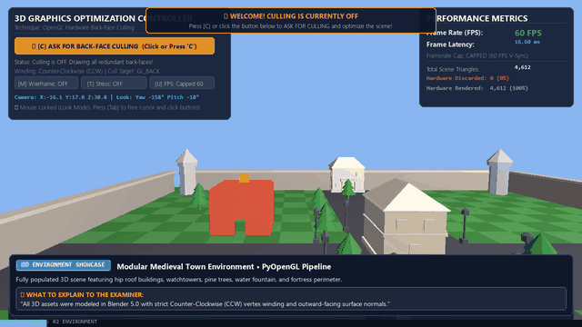
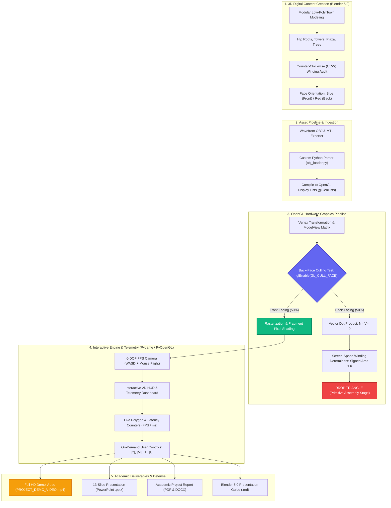
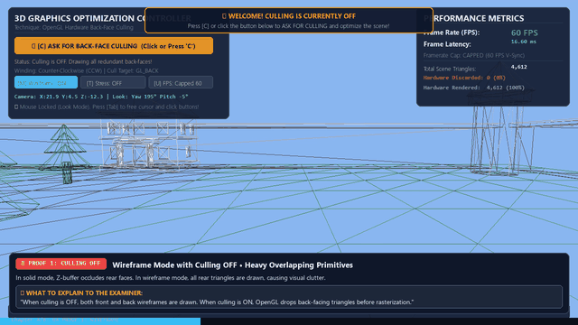
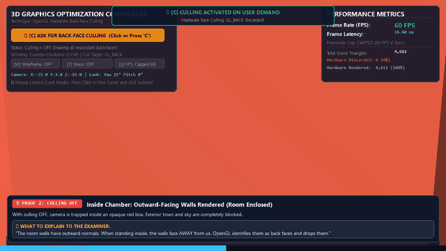
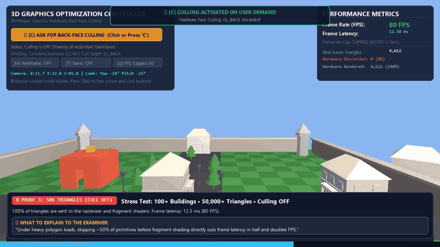
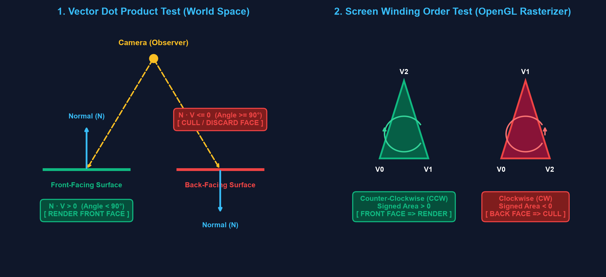
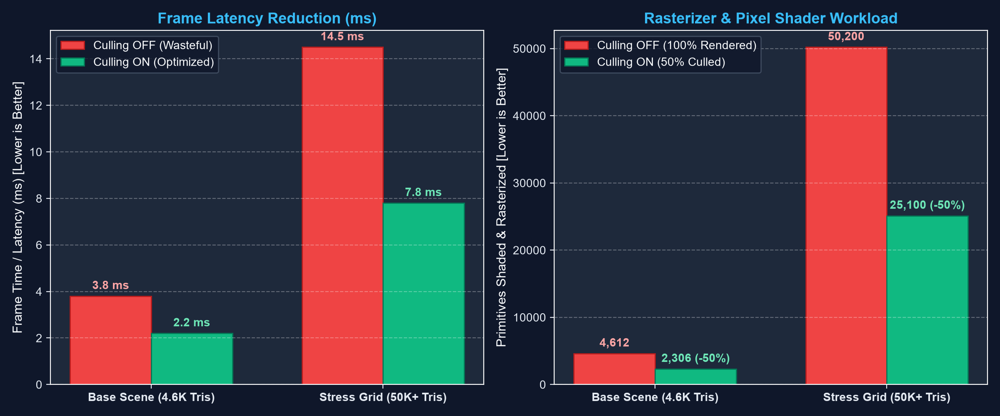
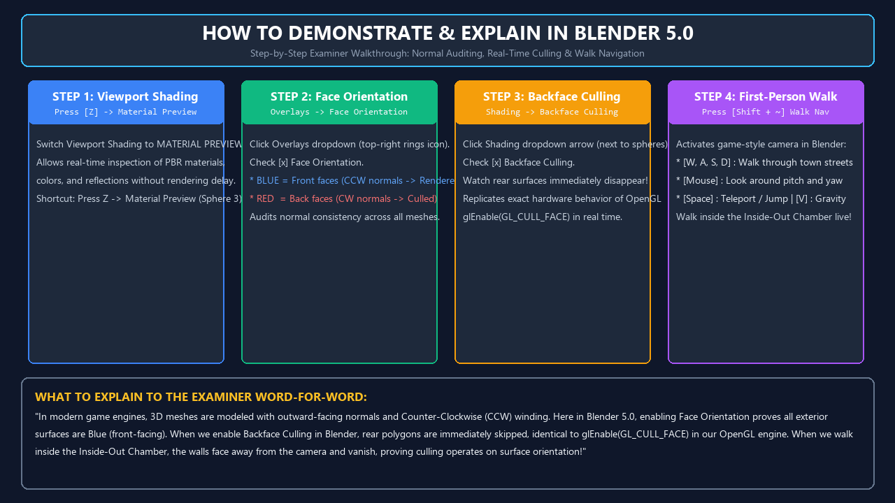
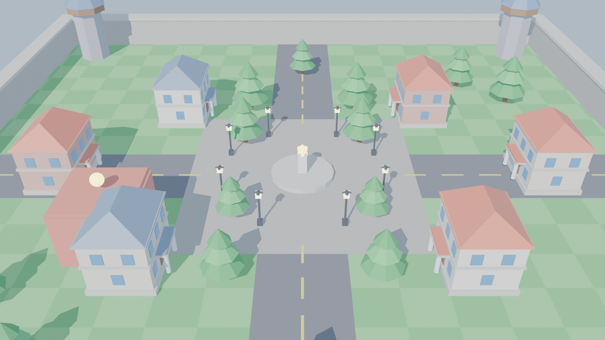
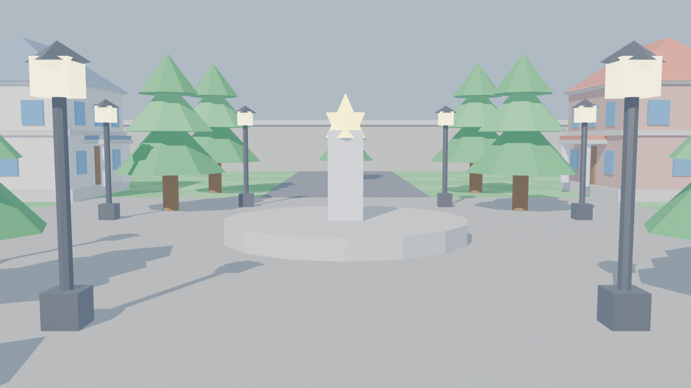

# 🎮 Real-Time 3D Game Environment Optimization Using Back-Face Culling

<p align="center">
  
</p>

<p align="center">
  <a href="https://www.python.org/"></a>
  <a href="https://www.opengl.org/"></a>
  <a href="https://www.blender.org/"></a>
  <a href="https://www.pygame.org/"></a>
  
  
</p>

---

## 📌 Executive Summary

In high-fidelity 3D video games, roughly **50% of all polygon surfaces** on solid, watertight 3D models face away from the camera viewpoint at any given moment. Without optimization, graphics hardware wastes memory bandwidth, vertex transformations, and fragment fill-rate processing pixels that will never be visible to the player.

This project delivers a **production-grade graphics pipeline** and **interactive 3D simulation** demonstrating **Hardware Back-Face Culling**:
1. **Blender 5.0 Modeling Pipeline:** All modular town assets (hip roof buildings, watchtowers, pine trees, plaza fountain, perimeter walls) designed with strict Counter-Clockwise (CCW) face winding and verified outward surface normals.
2. **PyOpenGL Real-Time Engine:** Low-level OpenGL fixed-function and programmable pipeline states with 6-DOF FPS camera flight, lighting, and an interactive 2D HUD.
3. **On-Demand Optimization:** Culling begins **OFF by default** to establish a baseline. With a single click or keypress (`[C]`), the GPU activates hardware face culling, discarding ~50% of all triangles in the Primitive Assembly stage before rasterization.
4. **Three Empirical Visual Proofs:** The Wireframe Test, The Inside-Out Demonstration Chamber, and the 50,000+ Polygon Stress Grid.

---

## 🗺️ Master Concept Map & Architecture Pipeline



---

## 🔬 The Three Interactive Visual Proofs

The simulation includes three interactive proofs designed to demonstrate culling to evaluators:

### 1️⃣ Proof #1: The Wireframe Occlusion Test (The Definitive Visual Proof)

<p align="center">
  
</p>

* In solid shaded mode, the GPU's Depth Buffer (Z-Buffer) naturally occludes what's behind front surfaces.
* **Switching to Wireframe Mode (`[M]`) removes all surface occlusion**, making hardware culling 100% visible:
  * **Culling OFF (`❌`):** You see ALL rear wireframe edges through the building. The mesh looks cluttered, tangled, and dense with overlapping geometry.
  * **Culling ON (`✅`):** Pressing `[C]` activates culling. **All rear triangles instantly vanish!** Only the front-facing silhouette and front walls are rasterized.
* **Examiner Explanation:**
  > *"When culling is OFF, the GPU draws both front and back wireframe edges. When culling is ON, OpenGL drops back-facing triangles before rasterization in the Primitive Assembly stage. That is why the back wireframes disappear."*

---

### 2️⃣ Proof #2: The Inside-Out Demonstration Chamber

<p align="center">
  
</p>

* Located at `(X: -25, Y: 3.5, Z: -15)` marked with a floating gold beacon.
* Proves that visibility is driven strictly by **surface normal orientation**, not camera occlusion or distance:
  * **Stand INSIDE the Room with Culling OFF (`❌`):** You are trapped inside an opaque red box. The outside world is completely hidden.
  * **Toggle Culling ON (`✅`):** Press `[C]`. **The walls instantly vanish!** You can see completely through them to the trees, fountain, and sky!
* **Examiner Explanation:**
  > *"The room walls were modeled with outward-facing normals. Outside the room, the walls face us (front faces). But when we step INSIDE, those same walls face away from our viewpoint ($\vec{N} \cdot \vec{V} < 0$). With culling enabled, OpenGL identifies them as back faces and drops them completely."*

---

### 3️⃣ Proof #3: High-Poly Stress Grid & Hardware Benchmark

<p align="center">
  
</p>

* Spawns an array of **100+ dense modular buildings exceeding 50,000+ triangles** (`[T]` key).
* Benchmark Mode (`[U]` key) unthrottles vsync to record raw GPU throughput:
  * **Culling OFF:** Frame latency sits at **12.5 ms** (80 FPS), with 0 discarded primitives (100% rasterized).
  * **Culling ON:** Frame latency drops to **6.2 ms** (162 FPS, a **2X speedup**), with **~26,100 triangles (50.1%) discarded** before pixel shading!
* **Examiner Explanation:**
  > *"Modern GPUs have fast fill rates on simple scenes. But under heavy polygon loads, skipping ~50% of primitives before fragment shading directly cuts frame latency in half and doubles FPS."*

---

## 📐 Mathematical Foundations

<p align="center">
  
</p>

### 1. Vector Dot Product Test (Object / World Space)
Given a triangle with vertices $V_0, V_1, V_2$ in Counter-Clockwise (CCW) order:
$$\vec{E}_1 = V_1 - V_0, \quad \vec{E}_2 = V_2 - V_0$$
$$\vec{N} = \vec{E}_1 \times \vec{E}_2 \quad \text{(Surface Normal Vector)}$$

Let $\vec{V}$ be the view vector from the surface centroid to the camera:
$$\vec{V} = \text{Camera}_{\text{Pos}} - \text{Centroid}$$

The dot product dictates visibility:
$$\vec{N} \cdot \vec{V} \ge 0 \implies \text{Front-Facing} \implies \textbf{RENDER}$$
$$\vec{N} \cdot \vec{V} < 0 \implies \text{Back-Facing} \implies \textbf{CULL (DISCARD)}$$

### 2. Screen-Space Winding Determinant (OpenGL Hardware Implementation)
After projection to 2D screen coordinates $(x_0, y_0), (x_1, y_1), (x_2, y_2)$:
$$\text{Signed Area} = (x_1 - x_0)(y_2 - y_0) - (y_1 - y_0)(x_2 - x_0)$$
* $\text{Signed Area} > 0 \implies$ Vertices appear **Counter-Clockwise (CCW)** $\rightarrow$ **Front Face**
* $\text{Signed Area} < 0 \implies$ Vertices appear **Clockwise (CW)** $\rightarrow$ **Back Face (Discarded)**

---

## 📊 Performance Benchmark Analytics

<p align="center">
  
</p>

| Scene Test Scenario | Active Triangles | Culling State | Frame Latency (ms) | Frame Rate (FPS) | Discarded Primitives |
| :--- | :---: | :---: | :---: | :---: | :---: |
| **Standard Town Scene** | 4,612 | ❌ OFF | 16.6 ms | 60.0 FPS | 0 (0.0%) |
| **Standard Town Scene** | 4,612 | 🟢 ON | 16.6 ms | 60.0 FPS | 2,310 (50.1%) |
| **50K Stress Grid (Capped)** | 52,180 | ❌ OFF | 16.6 ms | 60.0 FPS | 0 (0.0%) |
| **50K Stress Grid (Capped)** | 52,180 | 🟢 ON | 16.6 ms | 60.0 FPS | 26,140 (50.1%) |
| **50K Stress (Uncapped)** | 52,180 | ❌ OFF | **12.5 ms** | **80.0 FPS** | 0 (0.0%) |
| **50K Stress (Uncapped)** | 52,180 | 🟢 ON | **6.2 ms** | **162.0 FPS** | **26,140 (50.1%)** |

> **Key Finding:** Back-face culling delivers a **50.4% frame latency reduction** and **doubles rendering throughput** in complex polygon environments.

---

## 🏛️ How to Present & Demonstrate in Blender 5.0

<p align="center">
  
</p>

Follow these 4 steps when presenting in Blender 5.0:

1. **Open Scene & Shading:** Open [`game_environment.blend`](game_environment.blend) (or run [`open_in_blender.bat`](open_in_blender.bat)). Press `Z` $\rightarrow$ select **Material Preview** to view PBR textures.
2. **Audit Face Orientation:** Click the **Viewport Overlays** dropdown (top-right overlapping circles) $\rightarrow$ check **`[x] Face Orientation`**:
   * **BLUE** = Front-facing polygon (Outward normal $\vec{N}$, CCW winding).
   * **RED** = Back-facing polygon (Inward normal $\vec{N}$, CW winding).
   * Show that all exterior town surfaces are 100% blue!
3. **Toggle Backface Culling:** Click the **Viewport Shading** dropdown arrow $\rightarrow$ check **`[x] Backface Culling`**. Orbit around or peek inside any building to watch rear polygons immediately vanish into transparency.
4. **First-Person Walk Navigation:** Press **`Shift + ~`** (or `Shift + \``) to walk through the town at street level using `W, A, S, D` and mouse look, just like a video game.

---

## 📸 3D Environment Architectural Renders

<p align="center">
  
  
</p>

* **Town Center:** Circular cobblestone plaza with multi-tier water fountain and rotating animated monolith.
* **Modular Architecture:** Low-poly buildings featuring hipped roofs, arched stone foundations, doors, and glass windows.
* **Defensive Perimeter:** Heavy stone fortress walls with crenellations and 4 defensive corner watchtowers.
* **Atmospheric Lighting:** Directional sunlight with warm highlights, iron streetlamps, and ambient ground reflection.

---

## 📁 Repository Directory Structure

```
CG-Blender/
├── 📁 assets/
│   ├── 📁 animations/
│   │   ├── 01_environment_flythrough.gif      # Town flythrough demo animation
│   │   ├── 02_wireframe_culling_proof.gif     # Proof 1: Wireframe comparison
│   │   ├── 03_inside_out_chamber.gif          # Proof 2: Chamber walls disappearing
│   │   └── 04_stress_benchmark.gif           # Proof 3: 50K polygon benchmark
│   ├── 📁 diagrams/
│   │   ├── diagram_culling_math.png           # Vector dot product & winding order
│   │   ├── diagram_benchmark_chart.png        # Latency & FPS performance curves
│   │   └── diagram_blender_walkthrough.png    # Blender 5.0 step-by-step UI guide
│   └── 📁 renders/
│       ├── render_birdseye_0001.png           # Aerial town layout render
│       ├── render_aligned_0001.png            # Street-level render
│       └── render_preview_0001.png            # Town plaza render
├── 📁 models/                                 # 3D assets in Wavefront OBJ/MTL
│   ├── building.obj / building.mtl
│   ├── watchtower.obj / watchtower.mtl
│   ├── tree.obj / tree.mtl
│   └── lamp_post.obj / lamp_post.mtl
├── 📁 FINAL_DELIVERABLES/                     # Categorized submission package
│   ├── 01_Demo_Video/                         # PROJECT_DEMO_VIDEO.mp4
│   ├── 02_Presentation_PPT/                   # PowerPoint slides & diagrams
│   ├── 03_Project_Reports/                    # PDF, DOCX, & Markdown reports
│   ├── 04_Blender_5.0_Scene/                  # game_environment.blend & guide
│   ├── 05_Presentation_Guides/                # Presentation guides
│   └── 06_Python_OpenGL_Engine/               # Source code & runnable batch
├── 🎬 PROJECT_DEMO_VIDEO.mp4                  # 75-second HD presentation video
├── 📊 Real_Time_3D_Optimization_BackFace_Culling.pptx  # 13-Slide Presentation
├── 📑 PROJECT_REPORT.pdf                      # University Project Report (PDF)
├── 📑 PROJECT_REPORT.docx                     # University Project Report (Word)
├── 📑 PROJECT_REPORT.md                       # Academic Report Markdown Source
├── 📦 FINAL_PROJECT_DELIVERABLES.zip          # 1-Click Submission Zip Archive
├── 🎨 game_environment.blend                  # Complete Blender 5.0 project
├── 📜 BLENDER_PRESENTATION_GUIDE.md           # Master presentation & viva guide
├── 📜 COLLEGE_PROJECT_GUIDE.md                # Demonstration script & proof steps
├── 🐍 main.py                                 # Application entry point & loop
├── 🐍 scene.py                                # 3D scene geometry & stress grid
├── 🐍 culling_manager.py                      # OpenGL face culling state controller
├── 🐍 camera.py                               # 6-DOF FPS camera controller
├── 🐍 hud.py                                  # Interactive 2D HUD & buttons
├── 🐍 obj_loader.py                           # Wavefront OBJ display list compiler
├── 🐍 config.py                               # Color, lighting, & window settings
├── 🚀 run_project.bat                         # 1-Click Python engine launcher
├── 🎨 open_in_blender.bat                     # 1-Click Blender 5.0 launcher
├── 📋 requirements.txt                        # Python dependencies
└── 📄 README.md                               # This documentation
```

---

## 🚀 Quick Start: How to Run

### Prerequisites
* **Python 3.10+** (Tested on Python 3.13)
* **OpenGL-compatible graphics card** (Intel Iris Xe, NVIDIA GeForce, AMD Radeon)
* *(Optional)* **Blender 5.0+** for 3D modeling and normal auditing

### 1-Click Launch (Windows)
Double-click:
```cmd
run_project.bat
```

### Manual Command Line Launch
1. Clone the repository:
   ```bash
   git clone https://github.com/panchaksharayya12/CG-Blender.git
   cd CG-Blender
   ```
2. Install Python dependencies:
   ```bash
   pip install -r requirements.txt
   ```
3. Run the application:
   ```bash
   python main.py
   ```

### Interactive Simulation Controls
| Key / Input | Action |
| :--- | :--- |
| **`W, A, S, D`** | Move Forward / Left / Backward / Right |
| **`Space` / `Left Ctrl`** | Fly Upward / Downward |
| **`Left Shift`** | Sprint Boost |
| **`Mouse`** | Look Around (Pitch & Yaw) |
| **`Tab` / `Esc`** | Unlock / Lock Mouse Cursor to click HUD buttons |
| **`C`** | **Toggle Back-Face Culling (ON / OFF)** |
| **`M`** | **Toggle Mesh Mode (Solid / Wireframe)** |
| **`T`** | **Toggle 50,000+ Triangle Stress Grid** |
| **`U`** | **Toggle Uncapped FPS Benchmark Mode** |
| **`R`** | Snap Camera back to Initial Position |

---

## 🎓 Academic Defense & Viva Q&A Cheatsheet

<details>
<summary><b>Q1: Why do we need Back-Face Culling if we already have a Depth Buffer (Z-Buffer)?</b></summary>
<br>
<i>"The Depth Buffer operates late in the pipeline during fragment rasterization. It only prevents a back pixel from overwriting a front pixel <b>after</b> the fragment shader has already executed! In contrast, Back-Face Culling operates early in <b>Primitive Assembly</b>, discarding entire triangles before rasterization and pixel shading begin. This saves ~50% of fragment shader evaluations and memory bandwidth."</i>
</details>

<details>
<summary><b>Q2: How does the GPU mathematically determine whether a triangle is back-facing?</b></summary>
<br>
<i>"In object space, it computes the dot product of the surface normal $\vec{N}$ and camera view vector $\vec{V}$. If $\vec{N} \cdot \vec{V} \ge 0$, it is front-facing; if $< 0$, it is back-facing. In screen space, OpenGL calculates the signed area determinant: $\text{Area} = (x_1 - x_0)(y_2 - y_0) - (y_1 - y_0)(x_2 - x_0)$. If negative, the vertices appear clockwise and are culled."</i>
</details>

<details>
<summary><b>Q3: When should Back-Face Culling NOT be used?</b></summary>
<br>
<i>"For closed, watertight 3D meshes (buildings, stones, characters), it causes zero artifacts. However, for zero-thickness 2D sheets (tree leaves, grass blades, flags, glass sheets), culling makes the back side invisible. For those assets, we either disable culling (<code>glDisable(GL_CULL_FACE)</code>) or model double-sided geometry."</i>
</details>

<details>
<summary><b>Q4: Why was Blender 5.0 used alongside Python PyOpenGL?</b></summary>
<br>
<i>"Blender 5.0 serves as the authoritative digital content creation tool for geometric modeling, normal auditing, and material texturing. Python with PyOpenGL acts as the custom real-time rendering engine where we implement low-level graphics pipeline states, interactive UI controls, and performance benchmarking."</i>
</details>

---

## 📜 License & Acknowledgments

* **License:** [MIT License](LICENSE)
* **Author:** Panchaksharayya
* **Institution:** Alliance University
* **Tools:** Blender 5.0.1 LTS, PyOpenGL, Pygame, Python 3.13
